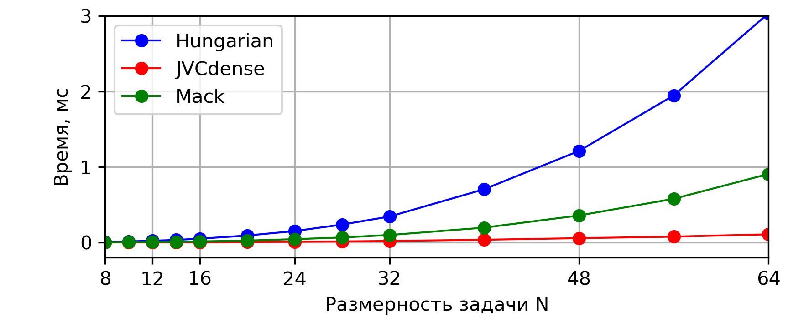
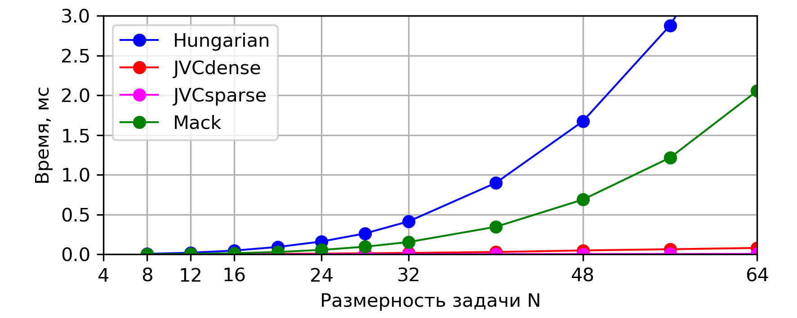
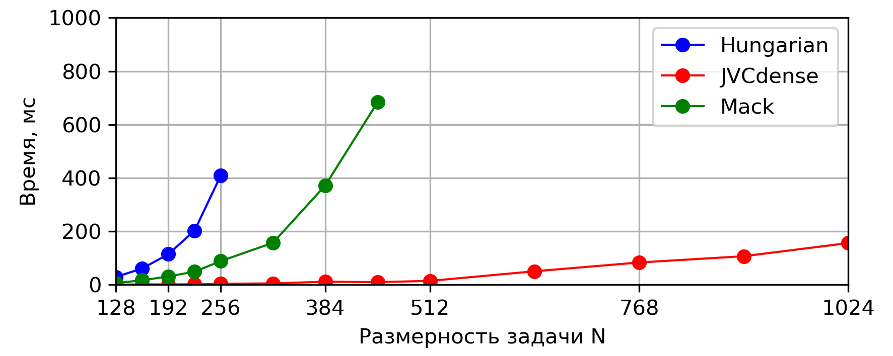
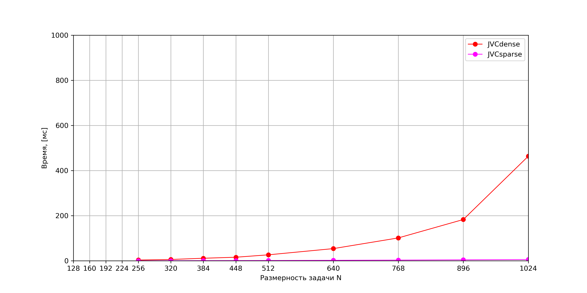
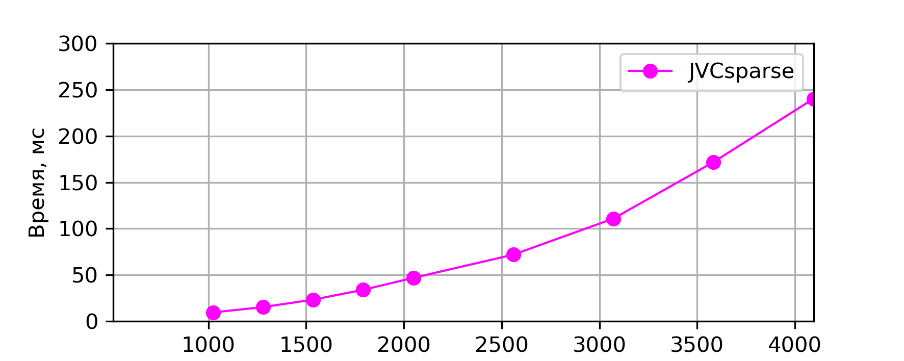
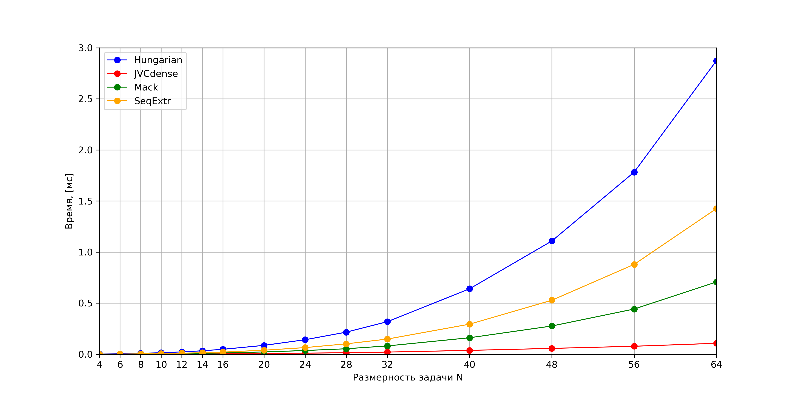
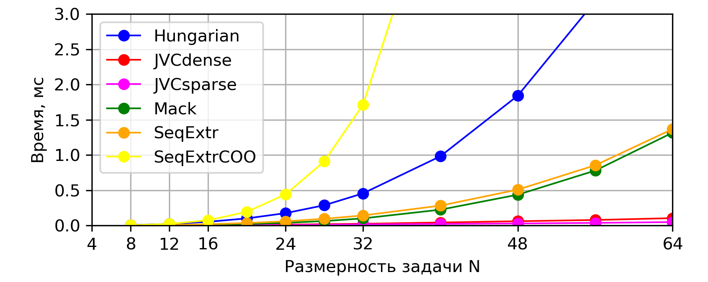

# LAP - Linear Assignment Problem / Линейная дискретная оптимизационная задача (задача о назначениях) #

## 1. Brief / Обзор ##
<br/> Solving linear assignment problem using / Решение задачи о назначениях методами:
* Jonker-Volgenant-Castanon method (JVC) for dense and sparse (CSR - compressed sparse row) matrices / Метод Джонкера-Волгенанта-Кастаньона для плотных и разреженных матриц в CSR формате
* Mack method / Метод Мака
* Hungarian (Munkres) method / Венгерский алгоритм
* Murty K-best method (uses JVCsparse inside) / Метод Мурти k-лучших решений (используется алгоритм JVCsparse внутри)

## 2. References / Ссылки ##
Papers / Статьи:
* R.Jonker and A.Volgenant A Shortest Augmenting Path Algorithm for Dense and Sparse Linear Assignment Problems Computing 38, 325-340 (1987)
* A.Volgenant Linear and Semi-Assignment Problems: A Core Oriented Approach
* Банди Б. Основы линейного программирования: Пер. с англ. - М.:Радио м связь, 1989, стр 113-123

Sites / Сайты:
* http://www.assignmentproblems.com/linearAP.htm
* https://www.mathworks.com/matlabcentral/fileexchange/26836-lapjv-jonker-volgenant-algorithm-for-linear-assignment-problem-v3-0

Repositories / Репозитории:
* https://github.com/yongyanghz/LAPJV-algorithm-c
* https://github.com/RcppCore/rcpp-gallery/blob/gh-pages/src/2013-09-24-minimal-assignment.cpp
* https://github.com/fuglede/linearassignment

## 3. Dependencies / Зависимости ##
<br /> Armadillo for matrices, Boost for testing / Armadillo для работы с матрицами, Boost для тестирования.

## 4. Tests / Тесты ##
* Сomparison of calculation speed on dense and sparse matrices / Сравнение скорости работы на плотных и разреженных матрицах
* Simple assignment problem matrices are provided / Дополнительные тесты на простых матрицах
* test JVC algorithm for looping / Тест алгоритма JVCdense на зацикливание

(Sparsity is ~20% / В разреженной матрице ~20% назначенных ячеек)

***
<center>Results for time measuring / Результаты замеров скорости работы:</center>

<center></center>
<?\image html  doc/pictures/denseSmall.png width=1000px?>
<?\image latex doc/pictures/denseSmall.png?> 
<center>Fig.1 - Execution time for dense matrices (small dimensions)<br /> </center>
<center>Рис.1 - Время выполнения на плотных матрицах (малые размернсти)<br /></center>

***

<center></center>
<?\image html  doc/pictures/sparseSmall.png width=1000px?>
<?\image latex doc/pictures/sparseSmall.png?> 
<center>Fig.2 - Execution time for sparse matrices (small dimensions) <br /> </center>
<center>Рис.2 - Время выполнения на разреженных матрицах (малые размернсти)</center>


***

<center></center> 
<?\image html  doc/pictures/denseLarge.png width=1000?>
<?\image latex doc/pictures/denseLarge.png?>
<center>Fig.3 - Execution time for dense matrices (large dimensions) <br /> </center>
<center>Рис.3 - Время выполнения на плотных матрицах (большие размерности)</center>

***

<center></center> 
<?\image html  doc/pictures/sparseLarge.png width=1000?>
<?\image latex doc/pictures/sparseLarge.png?>
<center>Fig.4 - Execution time for sparse matrices (large dimensions) <br /> </center>
<center>Рис.4 - Время выполнения на разреженных матрицах (большие размерности)</center>

***

<center></center> 
<?\image html  doc/pictures/sparseLargeExtra.png width=1000?>
<?\image latex doc/pictures/sparseLargeExtra.png?>
<center>Fig.5 - Execution time for sparse matrices (large dimensions) for JVCsparse<br /> </center>
<center>Рис.5 - Время выполнения на разреженных матрицах (большие размерности) для JVCsparse</center>

***

Additional graphs pics for methods of sequental extremum for dense and sparse matrices in dense and COOrdinated formats /
Дополнительные графики для методов последовательного выбора экстремума для плотных и разреженных матриц в обычном плотном виде и COO-формате.

***

<center></center> 
<?\image html  doc/pictures/denseSmallSeqExtr.png width=1000?>
<?\image latex doc/pictures/denseSmallSeqExtr.png?>
<center>Fig.6 - Execution time for dense matrices (small dimensions)<br /> </center>
<center>Рис.6 - Время выполнения на плотных матрицах (малые размерности)</center>

***

<center></center> 
<?\image html  doc/pictures/sparseSmallSeqExtr.png width=1000?>
<?\image latex doc/pictures/sparseSmallSeqExtr.png?>
<center>Fig.7 - Execution time for sparse matrices (small dimensions)<br /> </center>
<center>Рис.7 - Время выполнения на разреженных матрицах (малые размерности)</center>

## 5. Time measurements tables for sparse matrices / Сводные таблицы замеров времени выполнения для разреженных матриц

Table 1 - Execution time, milliseconds / Таблица 1 - Время выполнения, миллисекунды

<!--Таблица получена из теста time_table--> 

| N | 8 | 16 | 32 | 64 | 128 | 256 | 512 | 1024 |
| :-: | :-: | :-: | :-: | :-: | :-: | :-: | :-: | :-: |
| Hungarian | 0.007 | 0.046 | 0.369 | 4.358 | 66.083 | 1344.975 | - | - |
| Mack | 0.002 | 0.014 | 0.143 | 1.863 | 26.124 | 327.440 | - | - |
| SeqExtr | 0.004 | 0.018 | 0.141 | 1.336 | 16.591 | 238.068 | - | - |
| SeqExtrCOO | 0.002 | 0.009 | 0.045 | 0.297 | 2.663 | 39.466 | - | - |
| JVCdense | 0.002 | 0.005 | 0.020 | 0.083 | 0.418 | 3.185 | 26.182 | 586.341 |
| JVCsparse | 0.001 | 0.001 | 0.003 | 0.007 | 0.023 | 0.126 | 1.159 | 5.505 |

***

Table 2 - Increasing execution time relative to JVCsparse (times) / Таблица 2 - Возрастание времени выполнения относительно метода JVCsparse (разы)

<!--Таблица получена из теста time_table-->

| N | 8 | 16 | 32 | 64 | 128 | 256 | 512 | 1024 |
| :-: | :-: | :-: | :-: | :-: | :-: | :-: | :-: | :-: |
| Hungarian | 6.371 | 32.886 | 124.864 | 653.129 | 2908.809 | 10701.411 | - | - |
| Mack | 2.162 | 10.120 | 48.250 | 279.142 | 1149.913 | 2605.306 | - | - |
| SeqExtr | 3.730 | 13.170 | 47.842 | 200.191 | 730.270 | 1894.205 | - | - |
| SeqExtrCOO | 2.141 | 6.424 | 15.241 | 44.439 | 117.197 | 314.015 | - | - |
| JVCdense | 1.601 | 3.438 | 6.687 | 12.485 | 18.380 | 25.343 | 22.596 | 106.506 |

## 6. Murty K-best method / Метод Мурти k-лучших решений

Murty calls the same `SPM::LAP::JVCsparse` as ordinary sparse assignment tasks; there is no separate Murty LAP solver. A child reuses the parent's dual potentials and the assignments that remain allowed and tight. For rectangular problems, free column potentials are restored to zero before augmentation. Infeasible subproblems terminate when no augmenting path exists.
/
Murty вызывает общий `SPM::LAP::JVCsparse`, используемый и для обычной задачи о назначениях. Дочерняя задача использует потенциалы родителя и назначения, оставшиеся разрешёнными и двойственно жёсткими. В прямоугольной задаче перед поиском дополняющих путей потенциалы свободных столбцов приводятся к нулю. Недопустимая подзадача завершается, когда дополняющего пути нет.

`inf` is retained for API compatibility and does not cap individual or total costs; absent edges must be omitted from CSR. Potentials always refer to minimization: for `SP_Max` they correspond to negated costs. Feasibility is tracked separately from the objective value.
/
Параметр `inf` сохранён для совместимости API и не ограничивает отдельные или суммарные стоимости; отсутствующие рёбра не должны входить в CSR. Потенциалы всегда относятся к минимизации: для `SP_Max` используются стоимости с обратным знаком. Допустимость хранится отдельно от значения целевой функции.

`JVCsparse` supports optional input/output potentials and a read-only previous assignment:
/
`JVCsparse` принимает необязательные входные/выходные потенциалы и предыдущее назначение:

```cpp
arma::ivec x;
double cost = 0.0;
arma::vec u, v;
SPM::LAP::JVCsparse( csr, sp, inf, res, x, cost );          // обычный запуск
SPM::LAP::JVCsparse( csr, sp, inf, res, x, cost, &u, &v ); // получить потенциалы

arma::ivec parentX = x;
SPM::LAP::JVCsparse( childCsr, sp, inf, res, x, cost, &u, &v, &parentX );
```

`u` and `v` are separate vectors; no state wrapper is required. Empty or incompatible potentials select a cold start.
`rowsol_init` is optional: potentials can also be reused without a previous assignment. Return value is `0` on success,
`1` if no assignment exists. Invalid parameters or CSR throw an exception; infeasibility leaves outputs unchanged.
/
`u` и `v` передаются отдельными векторами. Пустые или несовместимые потенциалы означают холодный старт.
Начальное назначение необязательно: возможен повторный вызов только с потенциалами. Возврат `0` означает успех,
`1` — отсутствие назначения. Ошибки параметров/CSR вызывают исключения; при недопустимой задаче выходы не меняются.

The assignment covers every row and uses each column at most once. With more rows than columns, `JVCsparse`
returns `1` and `Murty::findNext` returns `false`. To allow unassigned rows, the caller must add dummy columns
with explicit costs. The solvers do not implicitly transpose or pad the matrix.
/
Назначение покрывает каждую строку и использует каждый столбец не более одного раза. Если строк больше столбцов,
`JVCsparse` возвращает `1`, а `Murty::findNext` — `false`. Для разрешения пустых назначений вызывающая сторона
добавляет фиктивные столбцы с явно заданными стоимостями. Автоматического транспонирования или дополнения нет.

`JVCdense(cost, dim, ...)` also supports square and horizontal matrices: `dim` must equal the number of rows,
and the number of columns must be at least `dim`. It assigns every row, leaves extra columns free, and sizes the
output vector automatically. All finite entries, including those equal to `infValue`, participate in the objective.
Vertical matrices and invalid inputs throw an exception without changing outputs; zero rows give an empty assignment
and zero cost. No padding is performed.
/
`JVCdense(cost, dim, ...)` также поддерживает квадратные и горизонтальные матрицы: `dim` равен числу строк,
а столбцов должно быть не меньше `dim`. Каждая строка получает назначение, лишние столбцы остаются свободными;
выходной вектор получает нужный размер автоматически. Все конечные элементы, включая равные `infValue`, входят
в целевую функцию. Вертикальная матрица и ошибки входа вызывают исключение без изменения выходов; ноль строк
означает пустое назначение и нулевую стоимость. Дополнение до квадрата не выполняется.

Table 3 - Data for Murty's method / Таблица 3 - Исходная матрица для метода Murty

Maximization; zeros denote absent edges in CSR. Each row must receive a distinct column.
/
Максимизация; нули обозначают отсутствующие рёбра в CSR. Каждая строка получает отдельный столбец.

|  -  | j=0 | j=1 | j=2 | j=3 | j=4 | j=5 |
| :-: | :-: | :-: | :-: | :-: | :-: | :-: |
| i=0 | 0.6 | 0.3 | 0.0 | 0.1 | 0.0 | 0.0 |
| i=1 | 0.0 | 0.2 | 0.7 | 0.0 | 0.1 | 0.0 |
| i=2 | 0.3 | 0.5 | 0.1 | 0.0 | 0.0 | 0.1 |

***

Table 4 - Solution for table 3 / Таблица 4 - Решение для таблицы 3

All 22 assignments are listed; column indices start at zero. Equal-cost assignments may appear in any order.
Times are medians of individual `findNext` calls over 1001 complete enumerations, after 100 warmup enumerations.
Each enumeration uses a new Murty instance; CSR conversion and construction are outside the timed calls.
Measured in Release (`-O3 -DNDEBUG`), GCC 12.2.0, Time unit: microseconds.
/
Перечислены все 22 назначения; индексы столбцов начинаются с нуля. Порядок решений с равной стоимостью произволен.
Время — медиана отдельных вызовов `findNext` по 1001 полному перечислению после 100 прогревочных перечислений.
Каждое перечисление использует новый экземпляр Murty; преобразование в CSR и конструктор находятся вне замеров.
Единица времени — микросекунды.

| K-best | Cost | Rowsol | Time, us (median) |
| :-: | :-: | :-: | :-: |
| 1 | 1.8 | 0 2 1 | 3.189 |
| 2 | 1.4 | 0 2 5 | 0.609 |
| 3 | 1.3 | 1 2 0 | 2.433 |
| 4 | 1.3 | 3 2 1 | 2.377 |
| 5 | 1.2 | 0 4 1 | 1.915 |
| 6 | 1.1 | 1 2 5 | 0.659 |
| 7 | 1.1 | 3 2 0 | 1.116 |
| 8 | 0.9 | 0 1 2 | 1.410 |
| 9 | 0.9 | 0 1 5 | 0.644 |
| 10 | 0.9 | 3 2 5 | 0.583 |
| 11 | 0.8 | 0 4 2 | 1.080 |
| 12 | 0.8 | 0 4 5 | 0.596 |
| 13 | 0.7 | 1 4 0 | 1.196 |
| 14 | 0.7 | 3 4 1 | 1.747 |
| 15 | 0.6 | 3 1 0 | 1.220 |
| 16 | 0.5 | 1 4 2 | 1.021 |
| 17 | 0.5 | 3 4 0 | 1.076 |
| 18 | 0.5 | 1 4 5 | 0.585 |
| 19 | 0.4 | 3 1 2 | 1.026 |
| 20 | 0.4 | 3 1 5 | 0.580 |
| 21 | 0.3 | 3 4 2 | 0.813 |
| 22 | 0.3 | 3 4 5 | 0.408 |

## 7. Conclusion / Вывод

JVCsparse is the fastest method from considered (for sparse matrices), cause it works with compact CSR storage and uses fast JVC algorithm. JVCdense is the fastest for dense.
Method of sequental extremum is non-optimal and it's usage is not recommended.
/ 
JVCsparse самый быстрый метод среди рассмотренных (для разреженных матриц), поскольку работает с матрицами, хранящимися в компактном CSR формате и использует быстрый JVC алгоритм. Для плотных матриц самый быстрый JVCdense.
Метод последовательного выбора экстремума неоптимален и его использование не рекомендуется.
